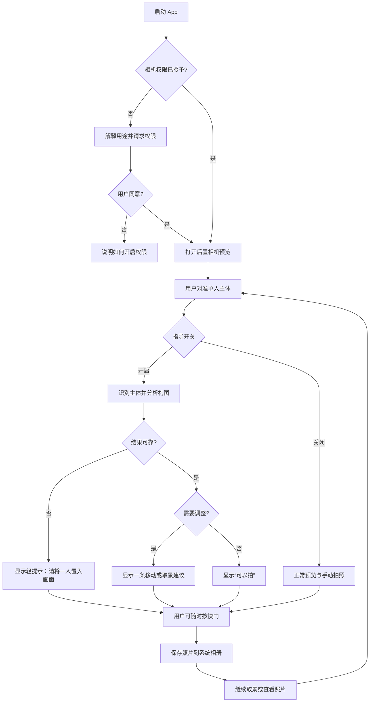
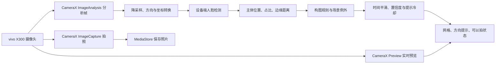
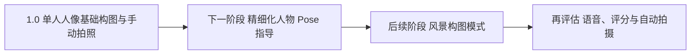

# 摄影 AI 构图大师：Android App 1.0 产品规划

更新：2026-09-29。首台真机：vivo X300。此文档是开发与验收计划，具体性能阈值需在真机测量后调整。

## 1. 产品定位

为拍摄者提供**拍照前、实时、简短、可执行**的单人人像构图建议。重点验证漫展返图与 COS 人像场景。用户始终可以正常手动拍照；建议不替用户决定审美。

**1.0 的一句话目标：**打开 App 对准一个人，画面上稳定地提示如何调整取景，构图合适时显示“可以拍”，按快门后能在系统相册找到照片。

## 2. 1.0 功能范围

| 功能 | 1.0 表现 | 验收重点 |
| --- | --- | --- |
| 相机 | 后置主摄实时预览、权限处理、手动拍照、保存到系统相册 | 首次授权、后台切回、旋转屏幕及连续拍照正常 |
| 人物定位 | 识别单人脸部；可用时结合身体关键点估计人体范围 | 识别不到、多人或遮挡时给出中性状态，不乱发指令 |
| 构图辅助 | 可开关三分网格；根据主体位置、画面占比和边缘裁切风险给出建议 | 提示对应实际画面，不强迫所有照片套三分法 |
| 实时提示 | 同一时刻只显示一条短提示，例如“向右移动手机”“退后一点”“注意头顶空间”；条件合适时显示绿色“可以拍” | 提示不遮挡主体，不随逐帧噪声反复跳变 |
| 基础控制 | 打开/关闭构图指导，手动快门，最近一张照片入口 | 关闭指导后仍是一台可用的相机 |
| 本地运行 | 1.0 的取景分析在设备上完成，无账号、无云端上传 | 断网时仍可分析与拍照 |

**暂不列入 1.0：**精细化人物 Pose 指导、风景构图、自动拍照、语音指导、多人合影、通用场景美学评分、云端大模型、复杂镜头切换与专业相机参数控制。其中**精细化人物 Pose 指导是 1.0 完成后的下一阶段重点**；风景构图排在 Pose 阶段之后。

## 3. 用户拍摄流程图

## 4. 技术实现流程图

CameraX 同时提供预览、图像分析和拍照三个用例。分析帧采用“只保留最新帧”的策略，忙时丢弃旧帧，优先保证取景流畅；预览与分析画面的坐标变换必须校准，避免箭头方向与用户看到的画面相反。

## 5. 构图判断的第一版思路

1. **先确认检测质量。**无脸、多人、脸太小、遮挡严重时不输出确定性移动建议。单人脸部是 1.0 的稳定锚点；身体范围检测作为增强，不把它设为拍照的前置条件。
2. **计算少量可解释的特征。**脸/主体中心相对画面的位置、主体宽高占比、头顶与左右边缘余量、眼睛大致位置。归一化到预览坐标，适配不同屏幕比例。
3. **输出一条优先级最高的提示。**先处理“人物被切掉、过近、过小”等明显问题，再处理三分法位置。水平和竖直方向不同时给出多条相互竞争的指令。
4. **处理摄影例外。**居中人像、对称背景等场景可允许“可以拍”；三分法是候选构图，不是硬性评分。1.0 可先提供“居中/三分”两种构图偏好，默认自动采用宽松规则。
5. **让提示稳定。**连续多次分析结果一致后才切换提示；设置容差区和最短显示时间。阈值由真机样本调试，不在纸面上假定最佳数值。

摄影知识参考 grimoire-core 的 [apply-rule-of-thirds](https://github.com/jeffreytse/grimoire-core/blob/main/skills/photography/composition/skills/apply-rule-of-thirds/SKILL.md)，把适用条件、例外与文案转化为 App 内规则。Skill 文本本身不在手机上负责识别画面。

## 6. 面向 vivo X300 的验证

vivo 中国官网的 X300 参数页标注 OriginOS 6（基于 Android 16）。开发时仍需读取**手上设备**的系统版本、相机能力和实测表现。首轮只使用后置主摄默认焦段；不承诺第三方 App 获得 vivo 原生相机的全部影像处理、镜头模式或最高像素能力。

真机检查项：

- 相机权限首次申请、拒绝后的恢复；离开 App 再返回时相机能否正常恢复。
- 竖拍为主，核对横拍与旋转后的预览、检测框、提示方向和保存照片方向。
- 室内漫展灯光、背光、多人背景、人物遮挡、半身/全身、COS 服装复杂轮廓下的提示质量。
- 连续使用时取景是否卡顿、手机是否明显发热、耗电是否影响拍摄。
- 拍照后系统相册可见，照片没有被分析用的低分辨率帧替代。

## 7. 开发阶段与交付物

| 阶段 | 交付物 | 通过条件 |
| --- | --- | --- |
| A. 相机底座 | 可安装 APK：权限、预览、快门、相册保存 | X300 上连续拍照与前后台切换正常 |
| B. 人物定位 | 实时脸部位置与调试框、坐标映射 | 移动手机时调试框跟随，横竖方向正确 |
| C. 构图引擎 | 主体占比与位置规则、一条提示、“可以拍”状态 | 在预先选定的样本场景中提示方向合理 |
| D. 交互完善 | 网格开关、指导开关、提示稳定化、异常状态 | 提示不闪烁、不遮挡主体；关闭指导仍能拍照 |
| E. 现场测试 | X300 漫展/COS 与普通人像拍摄记录、问题清单、修订版 APK | 至少覆盖近景/半身/全身、横竖拍、强弱光及复杂背景；记录误判并修正高频问题 |

## 8. 1.0 完成标准

- 能在 vivo X300 安装、启动、实时预览、手动拍照并保存到系统相册。
- 单人人像场景能给出稳定、易理解且方向正确的建议；无法可靠判断时明确降级。
- “可以拍”状态是辅助信息，快门始终由用户控制。
- 断网不影响核心拍摄与构图提示；不上传取景画面。
- 真机现场样本与问题记录留存，作为下一阶段精细化人物 Pose 指导的基线。

## 9. 1.0 之后的产品路线

| 阶段 | 重点功能 | 验证方式 |
| --- | --- | --- |
| 下一阶段：Pose 指导 | 身体关键点、头肩与四肢状态；针对单人站姿、半身照给出具体动作建议；处理道具、遮挡和画面裁切 | 用漫展/COS 实拍样本检查建议是否准确、可执行，以及是否与构图提示冲突 |
| 再后续：风景构图 | 独立风景模式；地平线、主体、留白、引导线与前中后景分析 | 建立风景样本集，分别验证对称、三分及其他构图情形 |
| 体验增强 | 语音提示、可控自动拍摄、美学评分等 | 以真机流畅度、提示价值和误触发情况决定是否加入 |

## 10. 参考依据

- [vivo X300 官方参数](https://www.vivo.com.cn/vivo/param/x300)
- [Android CameraX 架构](https://developer.android.com/media/camera/camerax/architecture)、[图像分析说明](https://developer.android.com/media/camera/camerax/analyze)
- [Google ML Kit 人脸检测](https://developers.google.com/ml-kit/vision/face-detection/)、[姿势检测](https://developers.google.com/ml-kit/vision/pose-detection/android)
- 本项目 [README.md](README.md) 列出的参考项目与定位
