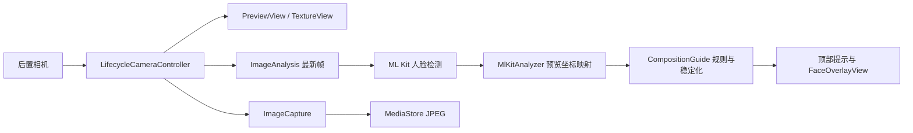

# 产品技术文档

整理日期：2026-10-15，依据 dev4 源码及验收记录。

## 技术栈

| 项目 | 配置 |
| --- | --- |
| 应用 | com.vinchen.photocomposition，Java + Android Views |
| 版本 | versionCode 4 / 1.0.0-dev4 |
| Android | minSdk 29，targetSdk 36，compileSdk release 37 / minor 0 |
| 构建 | AGP 9.4.0，Gradle 9.6.0，Java 编译级别 17 |
| 已验证 JDK | Android Studio 自带 JDK 25 |
| AndroidX | Activity 1.13.0、Core 1.19.1、Concurrent Futures 1.1.0 |
| CameraX | camera2 / lifecycle / view / mlkit-vision 1.6.2 |
| ML Kit | bundled Face Detection 16.1.7 |

参考项目未作为运行依赖；本版没有云端多模态模型。

## 数据流

## 代码职责

- MainActivity.java：权限、生命周期、相机、分析回调、控件、照片存储和查看。
- CompositionGuide.java：独立 Java 规则判定及时间状态机。
- GridOverlayView.java / FaceOverlayView.java：三分网格及人脸框。
- tests/CompositionGuideTest.java：26 项规则与稳定化检查。

## 预览与分析

PreviewView 使用 COMPATIBLE / TextureView，修复 X300 竖屏 SurfaceView 遮挡顶部控件。

分析目标尺寸 640×480，实际尺寸由相机协商；背压策略 KEEP_ONLY_LATEST。检测器 FAST 模式，最小脸比例 0.10，开启跟踪。MlKitAnalyzer 采用 COORDINATE_SYSTEM_VIEW_REFERENCED，规则输入为预览归一化脸框与 yaw/roll。

仅统计与预览矩形相交的人脸。回调通过生命周期、指导开关、cameraReady 和 generation 过滤失效结果。尺寸变化、停止和销毁时重置分析；1.5 秒无新结果撤销旧框和提示。回调及界面更新使用主线程 executor，性能待量化。

## 规则（按顺序判断）

| 条件 | 结果 |
| --- | --- |
| 无人 / 人数不为 1 | 无人 / 多人提示 |
| 非有限数、无效框、绝对 yaw >35° 或 roll >30° | 不可靠 |
| 任一边超出 0.035～0.965 内边界 | 靠边 |
| 脸高 <0.10 或宽 <0.08 | 太小 |
| 脸高 >0.55 或宽 >0.60 | 太近 |
| 中心 x <0.28 / >0.72 | 向左 / 向右移动手机 |
| 中心 y <0.22 / >0.52 | 向上 / 向下调整取景 |
| 其他 | 可以拍：脸部位置合适 |

位置按预览宽高归一化，阈值为待实拍校准的启发式参数。相机向左时静止主体在预览中向右，因此提示描述手机方向。没有身体边界、美学评分或三分交点吸附。

一般提示需至少 3 个样本、保持 500ms、距上次显示切换至少 800ms。无人、多人、不可靠、错误、太小立即重置；离开 READY 立即撤销肯定提示。保存期间暂缓覆盖状态，回调后保留 1800ms。

## 存储与权限

- CAMERA 为运行时权限；合并清单移除 INTERNET。依赖仍可能包含网络状态等权限，以最终清单为准。
- MediaStore 写入 DCIM/PhotoMaster，文件名 PhotoMaster_时间戳.jpg。
- SharedPreferences camera_preferences 保存网格/指导、最近照片 URI、权限请求历史。
- 分析帧不保存，网格及人脸框不写入照片。
- 关闭指导停用分析；初始化失败尝试保留拍照，单帧错误显示中性提示。

## 图标

design/app-icon/approved-icon.png 为确认原图，drawable-nodpi/icon_artwork.png 为同一资源。mipmap-anydpi-v26/ic_launcher.xml 是 icon/roundIcon 共用入口，前景 inset 12dp，背景 #F5F6F8。

## 已知问题

真实人物和复杂场景尚未完成验收；DataTransport 曾出现缺少 INTERNET 的后台异常，未为消除日志而开放权限，停用方式和资源影响待核查。帧率、功耗及温升尚未定量测量。当前为 debug 构建，正式签名与分发方案待建立。中文路径通过实验性 android.overridePathCheck=true 放行，其他机器需重新验证。
