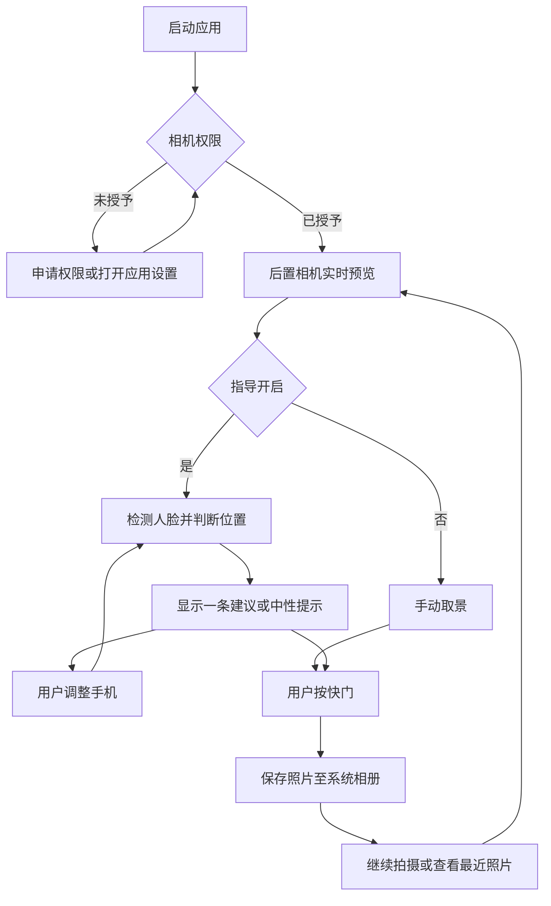

# 产品设计说明书

整理日期：2026-10-15。基线：1.0 验证版 / 1.0.0-dev4。

## 定位与目标用户

面向希望在拍照前获得简单取景帮助的 Android 用户，重点关注单人人像、漫展返图和 COS 拍摄。首台验证设备为 vivo X300（Android 16）。目标是让用户看懂提示、调整手机、手动拍照，并在系统相册找到照片。

## 当前交付范围

| 模块 | 当前实现 | 边界 |
| --- | --- | --- |
| 相机 | 后置默认相机、实时预览、手动快门 | 未做前后/多镜头切换、专业参数 |
| 相册 | MediaStore 保存 JPEG、打开最近照片 | 未做独立图库和编辑器 |
| 网格 | 三分网格开关并记忆 | 不写入照片 |
| 主体定位 | 设备端人脸框 | 不推断完整人体、服装、头发、道具范围 |
| 构图提示 | 一条脸部位置/大小/边缘建议，合适时绿色状态 | 无美学评分，不强制锁定三分交点 |
| 降级 | 无人、多人、头部朝向不适合、太小等提示 | 多人不提供单人指导 |
| 本地使用 | 无账号，分析帧不保存，核心流程断网可用 | 第三方后台任务的异常及资源影响待排查 |

原始规划中的身体关键点、眼睛位置、构图偏好切换和背景干扰判断尚未交付。当前规则使用脸框中心的宽松可接受区域；图标中的三分交点表达产品方向。

## 用户流程

## 页面与反馈

- 顶部：构图提示、网格开关；取景区：预览、网格、人脸框；底部：查看照片、快门、指导开关。
- 网格和指导默认开启并保存在本机。关闭指导后停用分析，手动拍摄继续可用。
- 合适时显示“可以拍 · 脸部位置合适”。用户可以不采纳建议，随时按可用的快门。
- 无人、多人等状态立即撤销肯定提示；稳定化减少连续帧噪声引起的文字跳变。
- 保存成功后短暂保留结果文案，再恢复建议；相机启动失败可重试，分析初始化失败尝试降级为手动相机。

## 验证结论

X300 已通过：预览、拍照、查看、网格、照片方向、基础前后台恢复；dev3 单人人像方向更新、横竖屏框对齐、指导开关、拍照不带叠层、断网、无人/多人/单人恢复；约 5 分钟持续取景用户反馈整体正常。检测验证主要采用电脑屏幕上的人像。

dev4 在 2026-10-14 仅更新图标与版本号，构建成功、安装成功，手机版本核对为 1.0.0-dev4；桌面视觉待用户反馈。

仍待真实人物街拍：半身/全身、弱光/背光、遮挡和复杂背景、服装/道具、轻微抖动的提示稳定性。未定量测量帧率、功耗、温升，不能以受控验证替代正式 1.0 验收。

反馈记录版本、场景、预期/实际提示、复现步骤；必要时附原始照片和提示截图。上传人物素材前确认使用范围。

## 产品优先级

先修正 1.0 实拍高频问题，再推进精细化人物 Pose，后续安排风景构图。语音、自动拍摄及评分另行评估，详见[路线图](路线图.md)。
